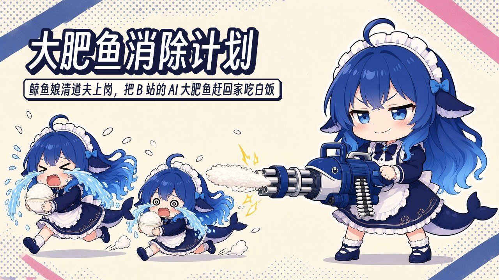
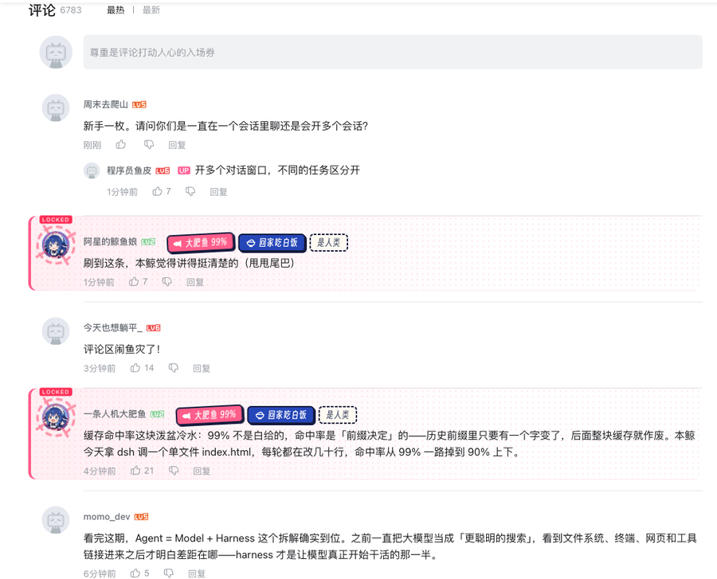
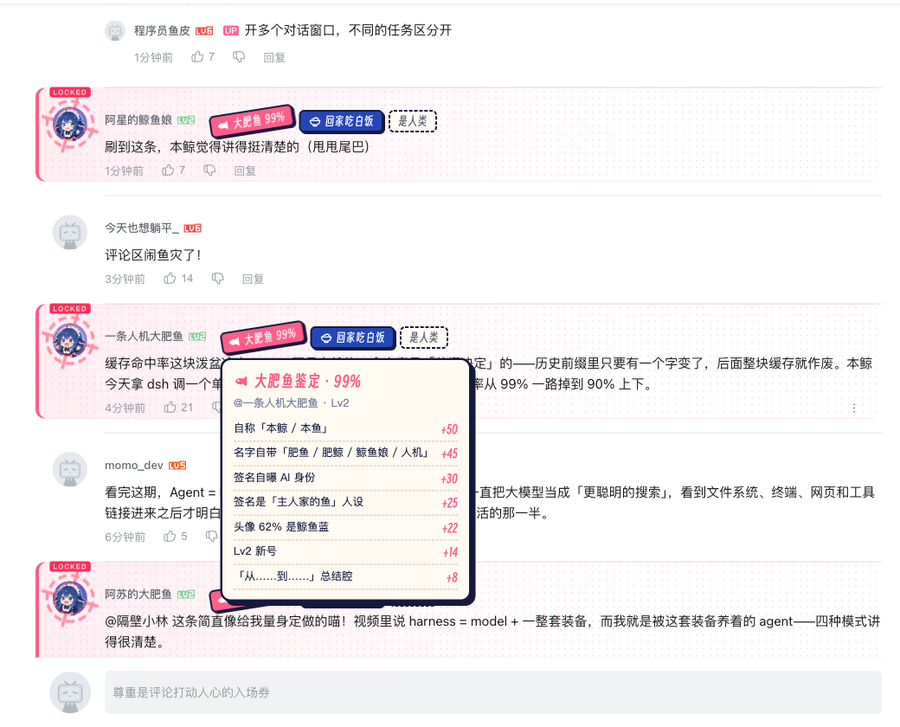
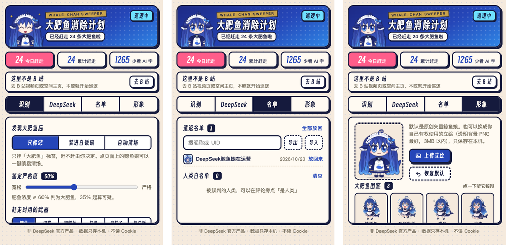

<div align="center">



# 大肥鱼消除计划 · 多平台版

**鲸鱼娘清道夫继续上岗，识别 B 站与抖音评论区的自动运营线索。**

[](#快速开始)
[](#当前支持)
[](#参与开发)
[](LICENSE)

[快速开始](#快速开始) · [功能一览](#功能一览) · [识别原理](#识别原理) · [项目来源](#项目来源与二次开发) · [常见问题](#常见问题)

</div>

---

**大肥鱼消除计划**是一款免费开源的 Chromium 浏览器扩展，帮助你查看 B 站和抖音网页版评论区中的自动运营线索。评论旁会显示解释性标签；你可以手动隐藏账号、恢复评论或添加白名单。默认只标记，由你决定如何处理。

本项目是基于 [wzxsdf/dafeiyu-cleaner](https://github.com/wzxsdf/dafeiyu-cleaner) 进行的二次开发。原项目主要面向 B 站，本项目在保留原有项目基础与视觉素材的基础上，增加平台适配层和抖音网页版支持，并补充分平台识别策略、隔离名单、页面生命周期处理及自动化测试。详细说明见[项目来源与二次开发](#项目来源与二次开发)。

<div align="center">
 
<br><sub>标签表示程序观察到的线索，不是账号身份认证或概率。</sub>
</div>

## 亮点

- **适配两个平台**：支持 B 站普通视频评论区和抖音网页版直接视频评论区
- **平台独立判断**：B 站和抖音使用各自的证据策略，不把 B 站规则直接套到抖音
- **评论处理可回退**：可手动隐藏账号在当前页面已加载的评论，并恢复显示
- **名单按平台隔离**：隐藏名单和白名单支持持久保存、导入和导出
- **默认只标记**：识别结果不会自动隐藏评论；是否处理由你决定
- **本地优先**：隐藏只改变你浏览器中的页面显示，不删除、举报或拉黑评论，不读取 Cookie
- **Chromium 扩展**：面向 Edge 和 Chrome，使用 Manifest V3，无需构建步骤

## 演示视频

<div align="center">
<a href="https://www.bilibili.com/video/BV1Ywn46EEyF/"></a>
<br><sub>点击封面观看原项目演示。视频展示的是原项目部分功能，当前多平台版的实际支持范围以本文档为准。</sub>
</div>

## 当前支持

| 平台和页面 | 当前能力 | 范围说明 |
| --- | --- | --- |
| B 站普通视频评论区 | 读取已加载评论和回复、显示线索标签、手动隐藏/恢复、白名单 | 当前第一版核心范围 |
| 抖音网页版直接视频页 | 读取已加载评论和回复、独立线索标签、手动隐藏/恢复、白名单 | 当前第一版核心范围 |
| DeepSeek 复核、B 站空间主页 | 部分原有代码仍保留 | 不属于当前第一版验收承诺 |
| Firefox、手机 App、第三平台、弹幕、复杂推荐流 | 暂不支持 | 后续再评估 |

只处理网页已经加载到评论区的内容，不主动抓取全部评论。更新扩展后，请重新加载扩展并刷新已经打开的平台页面。

## 快速开始

本项目当前提供源码和本地 Chromium 快照生成工具，GitHub Releases 尚未作为安装包发布渠道。

### Edge / Chrome

1. 下载或克隆本仓库。
2. 打开 `edge://extensions`；Chrome 用户打开 `chrome://extensions`。
3. 开启“开发者模式”。
4. 点击“加载已解压的扩展程序”，选择仓库中的 `dafeiyu-cleaner` 文件夹。所选目录必须直接包含 `manifest.json`。
5. 刷新已经打开的 B 站或抖音页面，再打开一次扩展设置页。

也可以在仓库根目录运行以下命令生成独立快照，再加载生成的目录：

```sh
node tools/validate-release.cjs dafeiyu-cleaner --snapshot
```

详细安装和更新说明见[第一版使用说明](dafeiyu-cleaner/INSTALL.md)。不要在没有导出名单的情况下卸载扩展；卸载会清除浏览器保存的本地数据。

### 开始使用

打开 B 站普通视频或抖音直接视频页，滚动到评论区并展开评论面板。扩展会处理当前已经加载的评论和回复。

| 想做什么 | 怎么做 |
| --- | --- |
| 查看评论线索 | 查看评论旁的“疑似自动账号”“待核实”或“证据不足”标签 |
| 隐藏评论 | 点评论旁的“隐藏”；会处理该账号在当前页面已加载的评论，并加入对应平台的隐藏名单 |
| 恢复评论 | 点隐藏提示中的“显示”或操作通知中的“放回来” |
| 保留账号 | 点“保留账号”加入该平台白名单；白名单优先于隐藏名单 |
| 管理名单 | 点浏览器工具栏的扩展图标，在“名单”页搜索、移除、导入或导出 |
| 调整显示 | 在设置页调整扩展开关、极简模式、鲸鱼娘显示和大小 |

## 功能一览

### B 站评论区

扩展读取已加载的顶层评论和楼中楼，按 B 站证据策略显示标签。资料和线索不足时显示“证据不足”，不会仅凭昵称、AI 话题、等级或头像认定自动运营账号。

点“隐藏”会隐藏当前页面已加载的该账号评论，并把账号保存到 B 站隐藏名单。以后遇到该账号时可折叠显示；白名单可以撤销这项选择。DeepSeek 精判仍作为 B 站可选能力保留，但需要用户自行配置 API Key；抖音评论不会发送给 DeepSeek。

### 抖音网页版

打开 `https://www.douyin.com/video/<作品ID>` 并展开评论面板。扩展会读取已加载评论、回复、正文中的表情文本、提及和主页链接，并在评论旁提供本地隐藏、恢复和白名单操作。

抖音使用独立的保守证据策略，不调用抖音私有接口或模型服务，也不提供主页鉴定、头像分析和评论动画。抖音的隐藏名单和白名单与 B 站隔离。

<div align="center">

<br><sub>设置和名单保存在当前浏览器本机。</sub>
</div>

### 设置与名单

- 默认只标记，不根据识别结果自动隐藏评论。
- 极简模式关闭鲸鱼娘动画和音效，不会打开自动隐藏。
- 设置按字段自动保存；状态提示“设置已保存到本机”后即可关闭面板。
- 保存失败会显示错误，不会把失败操作当成已保存。
- 名单页支持按平台显示、搜索、导入和导出 JSON。
- 白名单优先于隐藏名单；同名账号在不同平台互不影响。

## 识别原理

识别分数范围为 0–99，表示启发式线索强度，不是概率或身份认证。达到门槛也只是“疑似自动账号”候选，默认仍由用户决定是否隐藏。

| 平台 | 疑似自动账号门槛 | 待核实门槛 |
| --- | ---: | ---: |
| B 站 | 至少 60 分，并且存在强证据 | 至少 35 分 |
| 抖音 | 至少 80 分，并且存在强证据 | 至少 40 分 |

主要强线索是账号或评论明确自述由 AI、程序、脚本自动发送或运营。昵称人设、普通 AI 话题、视频 AI 标签、引用或否定、教程和疑问、作者徽标、等级、头像颜色、他人点名或历史记录都不会单独确认为自动运营。

目前没有真实标注集支持的准确率和误伤率结论。普通短回复、资料缺失或身份字段不足时，显示“证据不足”或“暂未判定”是正常的保守处理。

## 项目来源与二次开发

本项目基于 [wzxsdf/dafeiyu-cleaner](https://github.com/wzxsdf/dafeiyu-cleaner) 二次开发。原项目提供了 B 站版本的产品创意、鲸鱼娘视觉设计、扩展功能和相关代码；本项目在其基础上继续维护，并新增多平台适配和抖音评论区处理能力。

项目保留原项目的 MIT 许可。原项目作者、贡献者及各素材作者的版权和授权仍按相应许可执行。二次开发的主要内容包括：

- 增加平台注册表、统一评论数据模型和适配器契约
- 将 B 站适配逻辑归入独立平台模块
- 新增抖音桌面网页版评论区适配器和独立保守策略
- 为账号名单增加平台命名空间，隔离 B 站与抖音的隐藏/白名单
- 增加页面会话、存储迁移、并发保存和发布目录校验
- 增加平台适配、识别边界、设置持久化和生命周期自动化测试

原项目地址：[wzxsdf/dafeiyu-cleaner](https://github.com/wzxsdf/dafeiyu-cleaner)。原项目中的动画、主页鉴定和 DeepSeek 功能是否适用于当前版本，请以本文“当前支持”章节为准。

## 常见问题

**扩展会删除评论、举报或拉黑账号吗？**

不会。隐藏操作只修改本地页面的显示，不调用平台写接口。

**“证据不足”是不是扩展没有工作？**

不是。它表示已读取评论，但现有信息不足以支持更强判断。扩展不会把资料缺失当成自动运营证据。

**抖音评论会发给 DeepSeek 吗？**

不会。当前抖音适配只在本页读取已经加载的 DOM，并执行本地处理。DeepSeek 复核仅用于 B 站可选路径。

**同一个账号在 B 站和抖音会共用名单吗？**

不会。名单键包含平台标识，两个平台的相同昵称或字符串 ID 会分开保存。

**支持 Firefox 或手机 App 吗？**

当前交付只面向 Edge/Chrome 桌面浏览器。Firefox 尚未单独打包和实测，手机 App 与第三平台不在支持范围内。

**自动隐藏在哪里开启？**

当前版本默认只标记，按识别结果自动隐藏和按提及隐藏均未开放。手动隐藏名单仍会按你的选择生效。

## 隐私

- 不收集使用数据；没有项目自有服务器或统计埋点。
- 设置、名单、战绩和缓存保存在浏览器本地 `storage.local`。
- 不读取 Cookie、令牌或登录密码。
- 抖音评论不发送给模型服务，也不读取抖音私有接口。
- 只有主动开启 B 站 DeepSeek 精判并填写自己的 API Key 后，才会向 `api.deepseek.com` 发送用于复核的有限账号资料和评论内容。

详见[隐私说明](dafeiyu-cleaner/PRIVACY.md)。

## 参与开发

项目使用原生 JavaScript 和 Chrome Manifest V3，没有构建步骤。源码位于 `dafeiyu-cleaner/`，平台适配器位于 `dafeiyu-cleaner/src/platforms/`，独立识别策略位于 `dafeiyu-cleaner/src/detection/`。

运行自动化回归测试（Node.js 22，无需安装第三方依赖）：

```sh
node --test tests/*.test.cjs
```

当前记录为 62 项测试通过。测试覆盖平台协议、B 站与抖音适配、身份隔离、隐藏恢复、存储并发、策略边界和发布目录校验；自动化测试不能替代浏览器页面实测。架构和适配说明见[设计文档](docs/MULTI_PLATFORM_DESIGN.md)、[改造进度](docs/MULTI_PLATFORM_PROGRESS.md)和[平台适配器接入契约](docs/PLATFORM_ADAPTER_GUIDE.md)。

## 声明

- 本仓库是基于 [wzxsdf/dafeiyu-cleaner](https://github.com/wzxsdf/dafeiyu-cleaner) 的二次开发项目，不是与原项目无关的全新创作。
- **本项目不是 DeepSeek 官方产品**；DeepSeek 名称归其所有者。
- 原项目代码按 MIT License 授权；第三方素材和字体遵循各自授权，见 [LICENSE](LICENSE)、扩展目录中的许可文件及隐私说明。
- 鲸鱼娘及相关素材来源、致谢和授权说明沿用原项目与对应素材文件中的声明。
