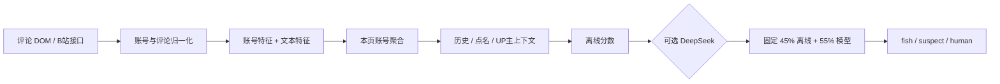

# B 站与抖音识别策略调研报告

**日期：** 2026-11-05  
**状态：** 研究结论，未实现本报告提出的识别策略  
**研究目标：** 评估当前 B 站识别逻辑，观察抖音评论区的实际数据形态，判断应抽象通用策略还是为抖音复制一套独立规则。

## 结论先行

当前最适合的方向是：**共用证据抽取、账号聚合、存储、模型编排和评估框架；B 站与抖音分别注册判定策略，并分别校准特征、阈值、缺失字段处理和展示政策。**

不建议把当前 B 站的分数和阈值直接搬到抖音，也不建议把两套完整规则复制成两份。当前 B 站规则捕捉的是“大肥鱼 / DSH 桌宠”这一特定生态，不能直接等同于“所有 AI 账号”或“所有 AI 生成评论”。抖音可以复用这套生态的部分语义特征，但评论结构、可获得的账号字段、作者标记、懒加载和页面上下文都不同，必须有自己的特征可用性声明和校准结果。

本报告只交付调研和方案，不改变生产识别逻辑。调研期间未修改生产源码；工作区此前已有的多平台适配改造保持原状。

## 1. 先定义要判定的对象

目前代码和提示词把以下几件事放在了同一个“AI 概率”里：

| 对象 | 含义 | 现有证据能否直接证明 |
| --- | --- | --- |
| 自动运营账号 | 账号由程序定时浏览、评论或发布 | 只有明确自述、可重复行为或外部证据才接近可证明 |
| AI 辅助写作 | 真人使用 AI 生成或润色某条评论 | 单条评论文本通常不能证明 |
| AI 话题参与者 | 只是在讨论 DeepSeek、AI 视频或鲸鱼梗的真人 | 不能因为话题相关就判为自动账号 |
| 垃圾/营销账号 | 重复、批量、广告或异常互动 | 与是否使用 AI 是不同标签 |

建议第一阶段把产品标签命名为“疑似自动运营账号”，并允许“证据不足/未判定”。“AI 生成视频”也只说明作品内容的标注范围，不能自动推出作者的每条评论都由 AI 发送。

## 2. 当前 B 站策略评估

### 2.1 实际处理链路

当前链路可以概括为：

主要实现位置：

- 离线规则：[`src/detector.js`](../dafeiyu-cleaner/src/detector.js)
- B 站策略注册和旧字段兼容：[`src/detection/bilibili-legacy.js`](../dafeiyu-cleaner/src/detection/bilibili-legacy.js)
- 评论聚合、历史、LLM 队列和结果混合：[`src/comments.js`](../dafeiyu-cleaner/src/comments.js)
- B 站评论提示词：[`src/background.js`](../dafeiyu-cleaner/src/background.js)
- B 站主页资料和投稿节奏：[`src/platforms/bilibili/profile.js`](../dafeiyu-cleaner/src/platforms/bilibili/profile.js)

### 2.2 当前策略的有效部分

1. **按账号聚合，而不是只看单条评论。** 同一账号的多条评论、楼中楼、历史页面记录可以合并，适合识别有稳定人设和重复行为的账号。
2. **有生态语义。** “本鲸/本鱼”“替主人刷”“住在 DSH”“括号里的尾巴动作”等组合证据，比单纯的 AI 关键词更接近“大肥鱼”生态的实际表达。
3. **有上下文入口。** 作者本人、被其他评论点名、跨页面历史和主页投稿节奏都已经进入判定接口，后续可以改成有明确证据等级的特征。
4. **检测策略已经注册化。** `DFY.detection.register('bilibili', ...)` 说明平台独立策略的接口方向是可行的；抖音不需要运行 B 站代码即可保持“暂未判定”。

### 2.3 影响准确性的关键问题

**一是规则名称和文本命中存在明显的语义误报风险。** 当前文本规则把“让我来”“照镜子”“过来打卡”“我会认真发评论”等普通中文短语放进了 46 分的 DSH 自曝规则。例如，合成探针中以下普通句子在没有账号资料时都会得到 46 分：

- “让我来解释一下这道数学题的解法”
- “照镜子才发现今天头发乱了”
- “我今天过来打卡，顺便看看大家”

在默认阈值 60 下，叠加 Lv2、蓝色头像或其他弱特征后可能直接进入 `fish`。这说明规则命中可以作为候选证据，不能直接当成已校准概率。

**二是名字、等级和头像颜色是弱证据，却可能抬高最终分数。** “大肥鱼/肥鱼/鲸”等昵称确实是该生态的线索，但也可能只是粉丝玩梗；Lv2 只代表账号等级；蓝色头像颜色检测并不等于识别出鲸鱼图像。抖音当前又没有相同的等级和头像分析字段，跨平台复用数值没有依据。

**三是引用、否定和谈论对象没有被充分区分。** `quoted-self` 探针中的“示例原文：‘本鲸替主人刷视频’……请勿模仿”仍会命中“本鲸”“替主人刷”和角色扮演规则。当前规则没有把引用、转述、反讽、否定上下文降权，也没有要求自述指向评论作者本人。

**四是“评论很像”与“评论内容很像”不是同一件事。** 账号重复加分主要依据本页评论数量和多条评论均为正分，并不计算文本相似度、时间间隔、跨视频重复模板或动作序列。一个真人在同一话题下连续回复，也可能被当成“每条都是一个味儿”。

**五是判定顺序和混合方式会放大边界问题。** 当前 `judge` 在第一条文本分数为 0 且没有理由时，后续较低分文本可能替换最佳文本；这是可复现的顺序依赖。LLM 结果又固定按“离线 45% + 模型 55%”混合，但没有校准集证明这个比例能代表概率。模型提示词还重复了离线规则的同一套生态假设，因此两者不是独立证据。

**六是“human”目前更像低分桶，不是已证实真人。** `levelOf` 会把低于怀疑线的账号显示为 `human`，而缺少数据时也会产生低分。产品语义上应该把“证据不足”与“已确认真人”分开，否则用户会把未观察到证据误读成反向证明。

**七是现有准确率声明无法独立复现。** README 中的“284 个账号、约 85% 召回、没有误伤真人”没有对应的标注集、抽样方法、账号/视频隔离、混淆矩阵或评估脚本。当前 29 项自动化测试主要覆盖协议、存储、DOM 生命周期和撤销操作，不能推出识别准确率。

### 2.4 B 站策略的研究判断

当前 B 站规则对“DSH 大肥鱼生态”有较高的可解释性，适合当作候选生成器；它还不具备跨平台通用分类器应有的概率校准、引用处理、缺失特征处理和可复现准确率证据。后续应先修正证据分层和评估方法，再决定是否增加更多文本规则。

## 3. 抖音样本观察

### 3.1 实测范围

使用用户提供的抖音搜索页定位后，改用对应的直接视频地址进行只读观察：

- [样本视频](https://www.douyin.com/video/7700631792398748938)
- 视频标题包含“小肥鱼/小鱼干/饭友/大米/碗”、`#普通人的ai发布会`、`#蓝色大肥鱼`、`#deepseek`
- 观察到 **91 条已加载评论**，其中 **85 条顶层评论、6 条回复**，归并为 **86 个账号**
- 这是一个视频、一个时间点、已加载窗口内的样本，不是随机抽样，也没有人工确认的 AI 真值标签

因此“76 个 human、9 个 suspect、1 个 fish”只是把当前 B 站规则做反事实套用后的**预测计数**，不是抖音准确率。

### 3.2 抖音当前可读取和缺失的字段

当前抖音适配器能稳定获得：

| 字段 | 样本情况 | 识别意义 |
| --- | --- | --- |
| `secUID` | 有，适合作为不透明账号 ID | 可跨评论聚合，但不要把 ID 当作语义 |
| 评论 ID | 有，当前从评论操作入口的数字 ID 读取 | 可做稳定评论键和撤销 |
| 昵称、头像 URL、正文 | 有 | 可做基础文本和账号聚合 |
| 回复关系 | 能区分顶层/回复，根评论可读 | 可区分作者回复和楼中楼上下文 |
| 提及 | 部分可读 | 可保留被提及账号 ID 和显示名 |
| 签名、等级、认证、绝对时间 | 当前样本均缺失 | 不能套用 B 站等级/签名权重 |
| 评论作者身份 | 页面上可见“作者”徽标，但当前归一化包没有稳定作者 ID | 需要单独建模，不能仅靠昵称判断 |

抖音页面存在动态渲染、评论懒加载、回复展开和节点重建。适配器已将这些作为生命周期问题处理，但研究数据仍然只代表当时加载出来的内容。当前读取评论作者链接的文本时，作者徽标可能与昵称处于同一可见结构中；应在判定前把徽标、菜单和插件 UI 与真实昵称分离。

### 3.3 抖音特殊语义

1. **作品的“内容由AI生成”是作品级标签。** 样本视频显示该标签，它可以说明视频内容的生成标注，但不能说明评论区每个账号是自动运营，更不能说明评论由 AI 发送。
2. **同一话题会诱导真人模仿生态词汇。** 样本评论大量讨论“饭友”“白饭”“杂鱼”、DeepSeek 和“大肥鱼”，这正是视频主题带来的语境。昵称带“肥鱼”或评论提到白饭，只能算弱线索。
3. **作者回复和普通观众回复的角色不同。** 样本中的作者账号“大肥鱼日记”带有作者徽标，公开主页可见“会写代码的大肥鱼，现在被主人放出来做视频”等人设描述；这支持“账号人设/项目背景”判断，但不能单凭公开简介证明每条评论由自动程序实时发送。
4. **回复文本需要父子关系。** 例如“小澪家的大肥鱼”的顶层评论和其回复“哈哈哈你也这么觉得嘛”应作为同一账号的两条不同角色证据；把回复与顶层评论混为一类会改变结果。
5. **抖音没有当前 B 站可用的等级、会员、签名和头像颜色特征。** 缺失不是负面证据，不能把“没有资料”换算为真人分或疑似分。

### 3.4 样本中反事实套用 B 站规则的表现

将样本字段映射到当前 B 站策略（不使用头像、作者豁免、点名和历史）后：

| 反事实结果 | 数量 | 解释 |
| --- | ---: | --- |
| human 低分桶 | 76 | 只能说明当前规则没有命中强关键词 |
| suspect | 9 | 主要由昵称中的“肥鱼”、`@` 长句或普通文本短语触发 |
| fish | 1 | 由昵称和 `@` 长句组合触发 |

几个可代表边界的匿名样本：

- **P01：** “小澪家的大肥鱼”，评论“好听诶，我投这个一票”，回复“哈哈哈你也这么觉得嘛”。B 站规则为 47 分；公开主页没有看到明确的自动运营声明。昵称和人设足以进入候选，但不能作为确认。
- **P02：** “雷霆大肥鱼”，评论以 `@` 开头并提出“叫饭友吧”。B 站规则为 45 分；实际被提及对象与“主人”的关系未知。
- **P03：** “大肥鱼日记作者”连续回复多条，当前规则仅因昵称得到 45 分；如果沿用“作者本人豁免”，会大幅改变结果。作者徽标应作为独立的角色证据，而不是全平台统一的人类豁免。
- **P04：** “肥鱼蓝碗婉”以 `@` 开头写较长推荐语，套用后达到 65 分；这更像“文本形式命中”，并不能证明自动运营。

这组结果说明抖音可以复用“DSH/大肥鱼生态”特征的**词典和证据类型**，但不能复用 B 站的数值、等级解释、作者处理和自动判定阈值。

## 4. 通用策略与独立策略的取舍

| 方案 | 优点 | 主要问题 | 判断 |
| --- | --- | --- | --- |
| 完全通用一套规则和阈值 | 开发量小，界面一致 | 平台字段和语境不同；缺失字段、徽标、回复结构会造成系统误报 | 不推荐 |
| B 站、抖音各自复制完整代码 | 可快速局部调参 | 规则、历史、缓存和提示词重复，长期容易漂移；修 bug 要改两处 | 不推荐 |
| 共用引擎 + 平台独立策略 | 复用基础设施，同时允许字段和阈值校准 | 需要把当前控制器中的 B 站假设进一步下沉为策略能力 | **推荐** |

推荐边界如下：

**适合共用的部分：**

- URL/DOM 读取后的统一模型、账号和评论聚合、回复关系、提及结构
- 稳定 ID、平台命名空间、页面会话、取消和节点清理
- 证据对象格式，例如 `observed`、`self_claimed`、`inferred`、`missing`
- 历史存储、白名单优先级、缓存失效、LLM 请求取消和结果校验
- 评估工具、标注格式、报告字段和“暂未判定”状态

**必须由平台策略负责的部分：**

- 可用字段掩码和缺失字段处理
- 作者/发布者角色、认证徽标和页面上下文的解释
- 账号名、签名、正文、回复、提及和作品标签的权重
- 作品 AI 标签是否只作为上下文，不能直接变成账号分
- 平台独立的阈值、拒判区间、自动隐藏门槛和 LLM 混合方式
- 平台独立的提示词、样本选择和模型校准

实现上，`DFY.detection` 注册表已经提供了入口；但当前 `comments.js` 仍然硬编码了阈值、LLM 队列范围、固定 45/55 混合和缓存摘要格式。真正做到平台独立，还需要把这些参数改成策略能力。那是下一阶段的实现工作，本报告不在本轮修改。

## 5. 建议的后续阶段

### 阶段 A：确定标签和证据规范

先确定产品要识别的是“自动运营账号”、 “AI 辅助评论”还是“可疑垃圾账号”。每条证据记录来源和强度：

- `self_claimed`：账号签名或正文明确自述自己由 AI/程序运营
- `observed`：可重复的发布时间、评论模板、回复链或外部行为
- `context`：作者徽标、视频标签、楼中楼关系、视频主题
- `inferred`：名字像生态账号、文本风格、头像颜色等弱推断
- `missing`：字段没有采集到，不参与“真人”证明

### 阶段 B：建立跨平台标注集

每个平台至少覆盖普通话题、AI 话题、作者回复、普通粉丝玩梗、引用/否定、短评论、长评论、批量重复和明确自述。账号和视频要按主体隔离到训练、调参、测试集合，避免同一个账号出现在不同集合造成虚高结果。

初版报告应同时给出 precision、recall、真人误报率、覆盖率和拒判率。若要声称真人误报率低于 1%，例如在 300 个已确认真人账号上零误报，只能得到约 1% 的单侧 95% 上界，不能当成“已经证明长期误报率为 1%”。

### 阶段 C：实现共享证据层和独立策略

统一输出结构，但允许策略声明 `availableFeatures`、`strongEvidence`、`weakEvidence`、`abstainRange`、`llmPolicy`。先在影子模式计算，不自动隐藏；比较以下四组：当前 B 站规则、去掉弱字段的 B 站规则、抖音独立规则、共用证据层加平台校准。

### 阶段 D：保守上线

第一版只展示“疑似/证据不足/已加入名单”的解释，自动隐藏需要更高阈值和更高 precision。低分不再直接显示“真人”；作者徽标、AI 作品标签和普通话题词只做上下文，不单独触发账号结论。

## 6. 需要产品决策的事项

请在进入下一轮实现前确定：

1. 识别范围：只识别“大肥鱼/DSH 桌宠”生态，还是扩大到所有自动运营和 AI 辅助账号？
2. 首版动作：只标记并允许手动隐藏，还是达到验证门槛后自动隐藏？
3. “human”是否改成“证据不足/倾向真人”两段式，避免把低分当作事实？
4. 抖音是否允许在用户点击后读取公开主页作为增强证据，还是只使用当前评论区？
5. 是否接受后续调用 LLM 进行抽样复核，以及调用成本、隐私范围和可缓存时间？

## 7. 证据边界与可复核材料

- 生产源码基线：[`src/detector.js`](../dafeiyu-cleaner/src/detector.js)、[`src/comments.js`](../dafeiyu-cleaner/src/comments.js)、[`src/background.js`](../dafeiyu-cleaner/src/background.js)、[`src/platforms/douyin/shared.js`](../dafeiyu-cleaner/src/platforms/douyin/shared.js)。
- 合成探针结果：`C:/Users/魏子轩/.codex/visualizations/2026/11/05/01a1a99f-7dbd-7581-b3e3-f8b9c289be18/detection-audit-probes.json`。
- 抖音样本快照和反事实统计保存在同一调研目录；其中包含页面公开 DOM 和不透明账号 ID，不应作为产品数据提交仓库。
- 只观察了用户提供的一个视频和当时已加载的评论，没有模型调用、没有人工真值标注，也没有把样本统计解释成准确率。

