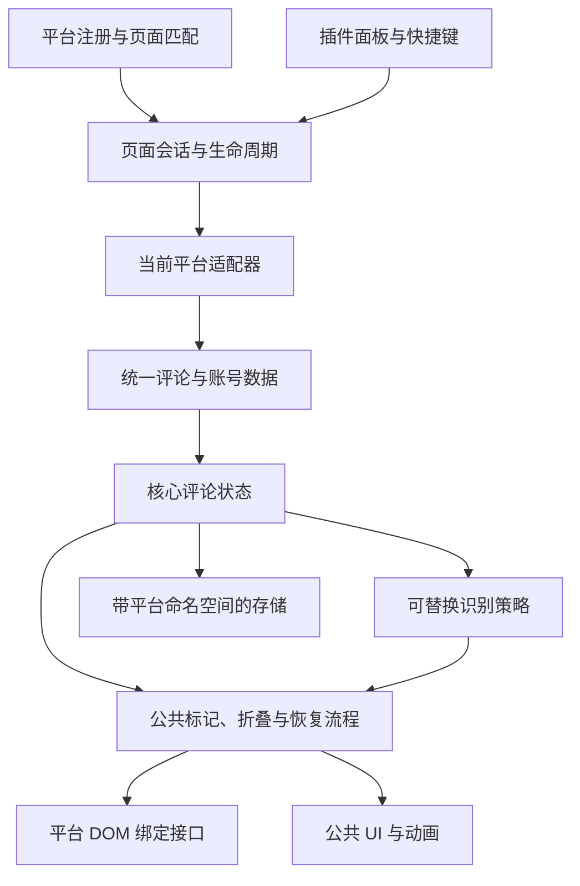

# 多平台适配设计与分期计划

状态：第 1 期适配底座和第 2 期抖音最小闭环已实现，继续推进完整扩展验收。  
设计日期：2026-11-05  
代码基线：manifest 版本 1.4.0；纯原生 JavaScript、Chrome MV3、无构建步骤。  
首批目标：保留 B 站现有能力，新增抖音桌面网页版评论区适配。

当前实现进度：已实现跨平台协议/身份模型、B 站适配迁移、页面会话、存储迁移及版本化名单；已根据真实抖音桌面评论区实现 DOM 采集，支持已加载评论和回复、独立证据策略、手动隐藏/恢复及平台独立名单。抖音不套用 B 站规则或调用模型，资料不足时保留“证据不足”。

实现及验收边界见 [改造进度](MULTI_PLATFORM_PROGRESS.md)；已经落地的接口见 [适配器接入说明](PLATFORM_ADAPTER_GUIDE.md)，抖音页面证据见 [抖音接入说明](DOUYIN_ADAPTER.md)。完整安装后的多平台回归仍需继续。

## 1. 目标与实施顺序

本轮优先解决“怎样稳定接入多个平台”，在适配闭环验收后，再提高 AI 评论识别准确性。

实施顺序：**现状基线 → 平台接口与 B 站迁移 → 抖音最小闭环 → 多平台稳定性验收 → 识别准确性专项**。

适配阶段的完成标准是：通过统一接口采集、展示和本地处理评论，正确隔离不同平台和不同视频的状态，新增平台无需修改核心流程。该阶段不以 AI 识别准确率作为发布门槛，也不宣称现有规则在新平台有效。

### 1.1 本轮必须具备

- 平台注册、匹配、能力声明与按平台加载。
- 统一的评论、账号、页面标识和可缺失字段语义。
- B 站现有功能迁移与回归验证。
- 抖音评论采集、标记挂载、手动隐藏、恢复，以及已加载回复的处理。
- 多平台名单、缓存和页面记忆隔离；旧 B 站数据迁移。
- 单页应用中的视频切换、评论面板重开、DOM 节点复用、异步任务失效处理。
- 不支持或数据不足时的明确降级状态。

### 1.2 后续再做

- 通用 AI 文风、机器人行为特征、平台专属规则的重新设计与权重调优。
- 模型提示词、阈值和分数融合策略的效果优化。
- 抖音个人主页鉴定、批量读取作品，以及其他平台的完整产品能力。
- 新增服务端、模型训练或远程账号数据库。

本方案面向浏览器网页，不能直接操作抖音等原生手机 App。不自动翻页抓取全站评论，不调用平台的发评论、举报、拉黑、删除等写接口，不读取或导出 Cookie。

## 2. 现状与改造依据

| 当前模块 | 已有职责 | 需要解除的耦合 |
| --- | --- | --- |
| `manifest.json` | 注入脚本、开放资源 | 注入范围与资源授权仅含 B 站 |
| `src/main-world.js` | 读取评论组件 `.data`，发送消息 | B 站组件名、账号字段、评论 ID、UP 主状态 |
| `src/comments.js` | 账号归并、判定、渲染、隐藏、动画编排 | 数据处理与 B 站 Shadow DOM 遍历、挂载、头像定位混合 |
| `src/ui.js` | 公共悬浮界面、泡泡大炮 | 命中评论时仍判断 `BILI-COMMENT-*` 标签 |
| `src/space.js` | 主页资料获取、鉴定与展示 | B 站域名、资料接口、作品列表、选择器 |
| `src/detector.js` | 离线评分与头像分析 | Lv 等级、VIP、鲸鱼特征、B 站图片处理后缀 |
| `src/background.js` | DeepSeek 请求、快捷键 | B 站提示词、头像地址后缀 |
| `src/storage.js` | 设置、名单、前科、缓存 | 直接用 `mid` 作键，页面编号主要匹配 B 站路径 |
| `popup/popup.js` | 设置、名单、导入导出、页面状态 | B 站主页链接、纯数字账号校验、平台文案 |

现有设计已具备两点基础：页面主世界与隔离世界通过消息交接数据；离线判定函数可以独立于 DOM 运行。改造应沿这两个边界拆分，保留 UI、素材和请求封装，避免另起一套扩展。

现阶段的“分数”是规则评分。现有模型输出也未经过概率校准，多平台上线不能将其解释为经过验证的真实 AI 概率。

## 3. 目标架构



职责边界：

- **平台适配器**处理平台域名、路由/视频定位、数据读取、评论节点定位、头像 URL、主页链接和页面主题映射。
- **核心层**处理评论与账号状态、名单优先级、任务调度、隐藏/恢复记录、统计与统一状态查询。
- **识别策略**只消费标准数据并输出判定，不能直接查询或修改平台 DOM。
- **公共展示层**生成标签、折叠条、提示与动画，通过适配器提供的绑定操作页面。
- **主页能力**是可选扩展，不能成为评论区启动的依赖。

核心层不得出现平台域名、`bili-*` 标签或抖音选择器。已知平台只在注册表、适配器、识别策略映射及必要的清单声明中出现，不能在 `comments.js` 中不断增加平台分支。

### 3.1 建议目录

```text
src/
  platform-registry.js
  core/
    models.js                 标识构造、数据校验、能力约定
    page-session.js           页面会话、切换、失效与清理
    comment-controller.js     统一数据接收、账号归并与操作编排
    comment-view.js           公共标签、折叠条、恢复入口
  platforms/
    bilibili/
      adapter.js              隔离世界的平台实现
      main-world.js           B 站主世界数据读取
      profile.js              原空间页的采集与页面定位
    douyin/
      adapter.js              抖音采集、节点绑定与页面定位
      main-world.js           仅在实测需要页面数据桥接时增加
  detection/
    registry.js               按平台选择策略
    bilibili-legacy.js         封装现有规则，先保留已有行为
  storage.js
  background.js
  content.js
  ui.js / fx.js / actors.js / weapons.js / ...
```

该目录是目标结构，可以逐步迁移。继续沿用 `DFY` 命名空间和显式脚本加载顺序，本轮不引入 React、TypeScript、打包器或平台 SDK。下文类型只是接口说明，不要求改用 TypeScript。

## 4. 统一数据与身份设计

### 4.1 数据模型

```ts
type PlatformId = string; // 已注册的平台名，例如 bilibili、douyin

interface PageContext {
  platform: PlatformId;
  pageKey: string;        // 平台内语义页面，如 video:xxx；不是简单截取 pathname
  sessionId: string;      // 每次激活或切换生成，离开再回来也必须不同
  type: 'video' | 'profile' | 'other';
  authorId: string | null;
}

interface Account {
  platform: PlatformId;
  id: string;            // 平台内稳定、不透明的字符串 ID
  name: string;
  avatarUrl: string | null;
  profileUrl: string | null;
  signature: string | null;
  features: {
    level?: number;
    verified?: boolean;
    vip?: boolean;
    // 平台可以补充特征；识别策略决定是否使用
  };
}

interface Comment {
  platform: PlatformId;
  pageKey: string;
  id: string;            // 优先使用平台提供的稳定评论 ID
  accountId: string | null;
  text: string;
  rootId: string | null;
  parentId: string | null;
  isReply: boolean;
  mentions: Array<{ accountId: string | null; name: string }>;
  createdAt: number | null; // 毫秒；平台采集层统一单位
}
```

约定：

- 账号键统一由一个函数生成，例如 `platform + ':' + encodeURIComponent(id)`；不允许业务代码各自拼接。
- 页面键由适配器根据当前作品身份生成；路径不变但视频变化，也必须产生新页面会话。
- 评论状态键同时包含平台、页面键和评论 ID，使用统一编码或元组序列化，避免分隔符碰撞。
- 任何 ID 都保持字符串，不使用 `Number()` 转换，不假设纯数字或长度上限为 20。
- 没有等级、认证、签名时保留缺失语义，不补成“Lv0”“未认证”或“新号”。
- 不以昵称或头像作为稳定账号 ID；同名账号不能合并。
- 如果只能获得临时评论标识，必须声明其会话有效范围。此时允许本页展示/隐藏，但禁止跨会话去重及账号记忆推断。
- 无稳定账号 ID 的评论仍可单条隐藏和恢复，但不进入持久名单、账号级连坐、前科或账号模型缓存。
- 同一账号后续获得更完整资料时，只合并有效字段，不能用缺失值覆盖已有资料。

### 4.2 判定模型

判定结果新增状态，而不是强制所有评论落入“人类 / 可疑 / 鱼”：

```ts
interface Verdict {
  status: 'unassessed' | 'assessed' | 'error';
  score: number | null;
  label: 'human' | 'suspect' | 'fish' | null;
  reasons: Array<{ code: string; text: string; weight: number }>;
  strategyVersion: string | null;
}
```

新平台没有适用识别策略时，返回 `unassessed`，界面显示“暂未判定”。它可以完成适配验收，但不能显示“本页很干净”或默认触发自动清场。已由用户手动加入该平台名单的账号，仍可按名单处理。

## 5. 平台接口与能力声明

### 5.1 适配器契约

```ts
interface PlatformAdapter {
  id: PlatformId;
  matches(url: URL): boolean;
  getPageContext(): Omit<PageContext, 'sessionId'>;
  getCapabilities(): Capabilities;

  // observer 先安装再采集初始快照；重复事件由核心按 ID 幂等合并
  start(context: PageContext, sink: AdapterSink, signal: AbortSignal): void;
  collectSnapshot(context: PageContext): Promise<CommentBatch>;
  getBinding(commentKey: string): CommentBinding | null;
  hitTestComment(target: Element): string | null;
  resolveAvatarUrl(account: Account, purpose: 'badge' | 'analysis'): string | null;
  resolveProfileUrl(account: Account): string | null;
  dispose(): void;
}

interface Capabilities {
  comments: boolean;
  replies: boolean;
  stableAccountId: boolean;
  stableCommentId: boolean;
  mentions: boolean;
  profileInspection: boolean;
  avatarAnalysis: boolean;
  commentAnimation: boolean;
}
```

`CommentBatch` 包含协议版本、平台、页面键、会话 ID、账号及评论数组。`AdapterSink` 提供评论新增/更新、绑定变化、能力变化及状态变化回调。接口声明与数据校验函数应在第 1 期固化为实际代码和样例。

`CommentBinding` 由隔离世界维护，至少包含：

- 当前评论的唯一键、绑定代次和有效性检查。
- 可挂载标签的容器、可选头像矩形获取函数。
- 隐藏/恢复操作、折叠占位挂载点、幂等清理函数。
- 本平台所需的样式作用域；不假定一定有 Shadow DOM。

核心通过绑定操作评论，不能直接读取 `#body`、`bili-comment-user-info` 等平台节点。泡泡大炮也必须走 `hitTestComment()`，避免遗漏 `ui.js` 中的 B 站标签判断。

适配器声明能力还不够：单条评论或当前页面可能缺少头像、账号 ID、回复等信息，调用前必须检查实际数据和绑定是否存在。

### 5.2 能力降级

| 条件 | 行为 |
| --- | --- |
| 平台不支持 | 不启动评论采集；面板显示当前站点不支持 |
| 支持平台，评论面板未打开 | 显示“尚未加载评论”，等待页面变化 |
| 登录或页面限制导致不可读取 | 显示具体受限状态，不将其统计为零评论 |
| 暂无识别策略 | 允许本地手动操作，显示“暂未判定” |
| 无稳定账号 ID | 禁止持久账号操作，保留单条隐藏 |
| 无头像或头像不可读 | 跳过颜色分析与头像动画，保留基础功能 |
| 未支持主页鉴定 | 隐藏主页鉴定入口，不影响评论功能 |
| 选择器失效或绑定异常 | 停止对该节点操作，提供重试与本地诊断信息 |

面板状态应区分 `unsupported`、`waiting`、`ready`、`restricted`、`degraded`、`error`，同时返回平台名、页面类型和能力信息，不能沿用“这里不是 B 站”的判断。

## 6. 页面生命周期与 DOM 操作

每个有效视频/主页创建一个会话。视频切换、评论内容所属作品变化或离开支持页面时：

1. 使旧 `sessionId` 失效，停止旧适配器的观察器和轮询。
2. 中止采集任务，取消队列中的判定、动画、计时器和自动处理。
3. 清理旧绑定、标签、折叠占位和插件施加的页面样式。
4. 清空当前页面账号、评论、已隐藏记录、临时放回名单、点名上下文和自动清场状态。
5. 读取新页面上下文并启动新会话；保留有平台隔离的持久名单和缓存。

路由检测不只依赖 URL：适配器需要识别作品 ID 变化。优先使用可观察的页面变化，必要时配合低频检测；不能在每次 MutationObserver 回调中全量扫描整个页面。

异步结果应用前，必须同时核对平台、页面键、会话 ID和任务版本。无法取消的后台模型请求也必须忽略过期回包；旧会话结果不得写入当前页面或覆盖较新的判定缓存。

对于虚拟列表，DOM 节点可能从评论 A 复用为评论 B。适配器必须先撤销 A 的状态，再绑定 B；只比较“节点已经处理过”是不够的。恢复操作也必须检查绑定代次，不能对已属于 B 的节点恢复 A 的样式。

隐藏前记录原始属性/样式及插件自己的占位节点；恢复时只撤销插件仍拥有的变更，避免无条件把平台原有的 `display`、`visibility` 设置覆盖为空。隐藏操作应幂等，同一评论不能因为重挂载而重复统计。

主题颜色、评论区滚动容器与裁剪区域由适配器提供。最小闭环只要求标签、隐藏和恢复；复杂头像动画可按能力关闭。

## 7. 页面数据桥与抖音采集策略

### 7.1 主世界桥接

B 站保留主世界读取组件数据的路径。其他平台先验证 DOM 是否足够，不强制所有平台注入主世界脚本。

需要桥接时，消息至少包含 `protocolVersion`、`platform`、`pageKey`、`sessionId`、`type` 和经过标准化的数据。主世界先收到当前会话的初始化请求，再发送该会话数据；隔离世界验证来源窗口、协议、平台、会话、消息类型、字段和条数/文本长度上限。

网页消息属于不可信输入；字段中的文本使用转义或 `textContent` 展示。`source` 标记和会话 ID 仅用于分流、去重和拒绝旧消息，不能当作安全认证。桥接不能接受 API Key、Cookie、任意后台请求 URL 或写入平台账号的操作指令。

### 7.2 抖音路径选择

第 0 期先对当前真实网页确认：作品定位方式、评论根节点、稳定评论 ID、稳定账号 ID、正文、回复关系和节点复用方式。2026-11-05 已取得首批 DOM 证据并记录于 [抖音接入说明](DOUYIN_ADAPTER.md)；选择器随网页变化仍需复验。

按以下顺序选取最小可行采集路径：

1. 读取已显示的 DOM，利用稳定属性和链接提取身份与正文。
2. 信息不足时，评估网页已经加载的页面状态，经主世界桥接补充。
3. 仍不足时，评估被动观察当前页面自然产生的评论响应；只提取必要字段，限定路径、体积和处理开销，并提供解除观察的方法。

不以独立调用私有签名接口作为首版前提。未加载的评论、折叠但未获取的回复不属于采集覆盖范围；用户展开并加载后再纳入处理。

若真实页面无法获得稳定账号 ID，抖音首版明确降级为评论级操作，而不是按昵称伪造身份。是否满足第二期发布范围，应根据第 0 期调查结果在文档中记录。

## 8. 存储、迁移与兼容

### 8.1 新存储结构

新增 `schemaVersion: 2`。名单、前科和缓存使用平台账号键；前科内的页面键也携带平台和页面类型。名单条目保存平台、原始 ID、显示名、头像、主页地址、时间和来源，区分用户手动加入与识别自动加入。

模型缓存至少包含平台账号键、策略/提示词版本、数据摘要和过期时间，避免不同平台、策略更新或输入明显改变后仍复用旧结论。适配阶段先实现可失效的结构，不开展缓存命中率优化。

现有设置提供默认值，新平台可以覆盖处理模式。B 站保留原设置；新平台默认只标记/手动操作，不直接继承用户原有的自动清场设置。阈值只对已启用的识别策略有效。

总战绩保留，新平台按平台记录增量；无法判断归属的历史统计保留为历史汇总，不编造细分数据。

### 8.2 迁移步骤

1. 后台统一入口检查存储版本，迁移完成前页面只读，不允许写入混合格式。
2. 在单独的旧版备份键中保存迁移涉及的数据；备份只保存一份，成功检查后按既定保留策略处理。
3. 把旧 `blocklist`、`whitelist`、`seen`、`llmCache` 的裸 `mid` 明确归入 B 站；旧页面编号转换为 B 站页面键，无法确认的前科页面不用于跨页计数。
4. 保留名单、时间、设置和汇总统计；旧模型缓存可迁移但标记旧策略版本，版本无法匹配时失效。
5. 检查条目数量、ID、字段和白名单优先级，提交新结构及版本标记，再开放写入。
6. 重复执行不重复增加命名空间；中断后可重试，失败时保留旧数据并报告状态。

读改写不是原子事务。迁移、名单操作和前科/缓存合并应经后台串行写入队列，所有页面和面板统一走该入口；禁止旧调用点继续直接整表覆盖。后台重启后重新检查持久版本与未完成迁移状态。

### 8.3 导入导出与回退

- 新导出格式为 `v: 2`，明确携带平台和原始字符串 ID。
- 原 `v: 1` 文件及简单数字名单继续按 B 站导入；新格式严格校验已注册的平台和字段。
- 新版导出应可完整回导，不能因数字正则拒绝其他平台 ID。
- 默认不合并同名账号；同一平台账号同时出现黑白名单时，白名单优先并记录冲突处理结果。
- 保留旧数据备份用于故障恢复；新版本生成的数据不能承诺被旧二进制直接读取。版本回退需恢复旧结构，或明确导出仅包含 B 站的兼容名单，不能依靠双写两套结构长期运行。

## 9. 适配阶段的识别策略边界

B 站使用 `bilibili-legacy` 策略包装现有离线规则和提示词，优先保持现有可观察行为。字段映射由兼容层完成，核心不再依赖 `mid/rpid/upMid` 命名。

以下属于适配正确性，必须在准确性专项前完成：

- 缺失等级不能转换成新号加分；不把其他平台认证值套进 B 站数值枚举。
- 不向其他平台头像追加 B 站图片处理后缀。
- 未支持的平台不调用 B 站提示词，不复用 B 站判定缓存。
- 没有稳定回复目标时跳过“被他人点名”的上下文规则；不能只靠重名建立关系。
- 暂未判定与“人类”分开展示，不能通过零分掩盖缺失能力。

抖音最小闭环默认没有自动 AI 判定；用人工加入的本地名单和测试环境可控判定验证标签、账号处理、折叠和恢复。测试判定不进入发布版本，不以随机分数或测试标签伪装真实识别。

后续可以选择复用部分通用规则，但必须在准确性专项中用样本证明，不作为完成适配的隐含任务。

## 10. 分期计划与验收门槛

各期按交付条件推进，不在缺少抖音实测结果时承诺日历工期。适配主线是第 0～3 期；第 4 期独立安排。

| 阶段 | 目标 | 主要交付 | 退出条件 |
| --- | --- | --- | --- |
| 第 0 期：基线与调查 | 固化现状，确认抖音可行路径 | B 站行为清单、抖音页面观察记录、最小数据样例、能力矩阵 | 确认作品和评论定位路径；稳定 ID 的可用性和降级边界有证据 |
| 第 1 期：适配底座 | 建立契约并迁移 B 站 | 注册表、数据模型、会话管理、B 站适配器、存储迁移、面板状态 | B 站主要功能回归通过；核心无平台 DOM/域名判断；旧数据可迁移 |
| 第 2 期：抖音最小闭环 | 用真实第二平台验证抽象 | 抖音评论适配器、按平台清单配置、基础标记/隐藏/恢复、名单管理 | 可读取已加载评论；切视频与节点复用无串数据；未判定状态正确 |
| 第 3 期：多平台稳定性 | 完成发布所需验证并固化扩展流程 | 双平台回归、资源清理、并发写入与降级验证、适配器开发指南 | 双平台可同时使用；平台隔离、生命周期和数据兼容测试全部通过 |
| 第 4 期：识别准确性 | 在稳定采集基础上改善判断 | 标注集、评测脚本、平台策略、提示词与阈值方案、误判分析 | 按专项确定的准确率/召回率/误伤指标验收，不只看命中数 |

### 10.1 第 0 期任务

- P0-01：记录 B 站主评论、回复、标记、折叠、手动赶走、撤销、自动清场、@ 隐藏、空间报告、模型判定和泡泡大炮行为。
- P0-02：观察抖音视频页和推荐流中的评论面板；记录作品切换和评论节点是否复用。
- P0-03：确认 DOM / 页面状态 / 自然响应三种路径中必要且最小的一种，记录字段可见性和稳定性。
- P0-04：收集去标识化的页面/数据夹具；无法稳定支持的能力标为不支持或待验证。

### 10.2 第 1 期任务

- P1-01：实现数据模型、键构造、校验器、能力声明和平台注册表。
- P1-02：把 B 站采集和 DOM 定位移入适配器，保持现有脚本依赖顺序。
- P1-03：拆分评论控制与视图，迁移泡泡大炮命中检测、头像地址和主页链接生成。
- P1-04：实现会话生命周期、节点重新绑定和旧任务失效机制。
- P1-05：实现存储 v2、后台串行写入、旧数据迁移和双版本名单导入。
- P1-06：把空间页变成 B 站可选能力；更新面板平台状态与操作入口。
- P1-07：封装 B 站旧识别策略并完成回归，必要兼容修正单独记录。

### 10.3 第 2 期任务

- P2-01：按第 0 期调查实现抖音采集、身份提取和作品上下文。
- P2-02：实现标签挂载、单条隐藏/恢复和稳定账号的名单操作；无账号 ID 时降级。
- P2-03：实现评论面板重开、滚动追加、回复展开、视频切换和节点复用处理。
- P2-04：分别配置抖音脚本注入和资源域名；只有需要时增加主世界桥和资源/CDN 权限。
- P2-05：落实“暂无判定策略”状态、按平台默认设置和面板说明。

第 2 期不要求个人主页鉴定、头像动画或新平台自动识别。已声明支持的能力必须可用，不能用“适配器文件已创建”代替真实闭环。

### 10.4 第 3 期任务

- P3-01：同时打开 B 站和抖音，验证名单、前科、缓存、面板命令和存储并发。
- P3-02：验证页面切换、节点复用、观察器释放及模型过期回包。
- P3-03：用测试适配器验证通用契约；新增适配器只需注册、清单和平台文件，不修改核心。
- P3-04：记录加载失败、登录受限、头像跨域失败、无回复或无账号 ID 等降级行为。
- P3-05：在 Chrome / Edge / Firefox 分别验证声明支持的路径，更新 README、架构及隐私说明。
- P3-06：按能力逐项发布，未完成的能力在界面和文档中明确关闭。

第三个真实平台（如快手或 YouTube）可在适配主线完成后接入，用于进一步检验架构，但不与首批验收绑定。

### 10.5 第 4 期任务

- P4-01：明确判定对象：单条 AI 辅助文本、持续自动运营账号、广告机器账号分别统计，避免把不同目标混成一个标签。
- P4-02：为 B 站、抖音分别构建人工复核样本，包含真人玩梗、AI 讨论、短评、长评和自曝机器人等边界情况。
- P4-03：按账号及视频隔离训练/调参与验收样本，防止同一账号和重复评论泄漏。
- P4-04：评估精确率、召回率、误伤率和不确定样本比例；样本允许“无法确认”，不能只按文本风格强行给真值。
- P4-05：再决定通用与平台专属规则、模型提示词、触发条件、融合权重和缓存策略。
- P4-06：只有满足单独确定的高精确率门槛后，才考虑在新平台默认或推荐开启自动隐藏。

## 11. 验证方案

适配期测试重点是数据、状态和 DOM 操作正确性，不编写“存在某个选择器字符串”之类的实现镜像测试。纯原生项目可使用 Node 内置测试运行器验证模型/迁移函数，DOM 夹具和真实扩展加载负责页面行为验证；是否引入浏览器测试依赖由实施时评估。

| 场景 | 必须验证的结果 |
| --- | --- |
| B 站原有主评论与楼中楼 | 数据归并、标签、名单、撤销行为与基线一致 |
| 两平台原始账号 ID 相同 | 黑白名单、前科、模型缓存互不影响 |
| 重名但账号 ID 不同 | 不合并，不传播账号级隐藏 |
| ID 包含字母、特殊字符或长数字 | 无精度损失，可导出回导 |
| 缺失等级、头像、签名、账号 ID | 不伪造特征，不产生持久身份关联 |
| 同评论重复采集、移出再挂载 | 不重复插标签、不重复计数，隐藏状态符合当前会话 |
| DOM 从评论 A 复用为 B | A 的标签和隐藏状态不污染 B |
| 视频 A → B → A，URL 可保持不变 | 每次新会话独立，旧任务不能回写 |
| 关闭再打开评论面板 | 正确重新绑定，观察器与占位不重复 |
| 隐藏、折叠、恢复、加入白名单 | 只撤销插件自身变更，统计与实际处理一致 |
| 迁移中断、重复迁移、旧名单导入 | 无丢失、无重复命名空间、白名单优先 |
| 多标签页同时加入不同账号 | 全部保留，后台重启后仍可继续写入 |
| 选择器失效、登录受限、头像请求失败 | 明确降级，不冒充“无评论”或“全是人类” |
| 关闭设置、离开支持页、销毁适配器 | 停止处理并清理观察器、计时器、绑定与临时 UI |

资源验收建议至少连续切换 20 次视频、开关 10 次评论面板：活动观察器、计时器和页面绑定数量不随历史会话持续累积，已结束会话无后续 DOM 写入。该次数是生命周期检查，不是性能或准确率证明；性能数据应记录设备和页面样本。

## 12. 发布与文档要求

- 分阶段保持可加载的扩展，先交付 B 站迁移，再接入抖音；不把整个重构压成一次不可验证的替换。
- B 站现有用户的识别和模式配置尽量保持，迁移失败时停止新增写入并提供恢复说明。
- README 明确“平台已适配”和“AI 判定已支持”的差别，列出各平台能力矩阵。
- 架构文档在实现合并时同步更新，本文在各期结束后补充实际接口、验证结果和偏离原因。
- 隐私说明同步新增平台、实际读取的数据、头像/CDN 访问和可选模型传输内容；沿用本地存储及模型请求开关。
- 发布清单包含 Chrome / Edge 与 Firefox 差异，不扩大到所有网站或请求无关权限。

## 13. 风险与处理

| 风险 | 处理方式 |
| --- | --- |
| 抖音 DOM 或页面状态不稳定 | 先实测，隔离到适配器；采集与绑定分离，失效时明确降级 |
| 评论区虚拟列表导致隐藏错位 | 绑定代次、身份校验、撤销旧绑定，再应用新状态 |
| 新平台无稳定身份 | 评论级功能先运行，禁用需要持久身份的能力 |
| 重构导致 B 站功能退化 | 先建立基线，以 B 站作为首个真实适配器逐步迁移 |
| 多标签页或迁移并发丢数据 | 后台统一串行写入，迁移版本检查与幂等恢复 |
| 适配工作被识别优化不断扩大 | 第 0～3 期按接口和行为验收，规则效果问题进入第 4 期 |
| 旧识别规则在抖音误伤 | 默认未判定/手动模式，不运行 B 站专用规则与提示词 |

首个可交付成果应是“完成统一底座且 B 站回归通过”；首个多平台成果应是“B 站与抖音在同一核心下完成评论采集和本地处理”。随后再以独立样本和指标推进 AI 识别准确性。
